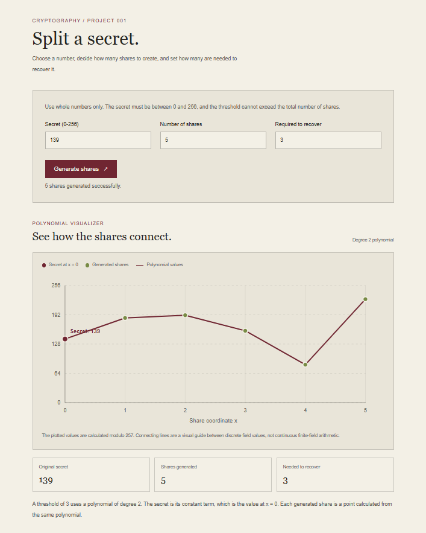
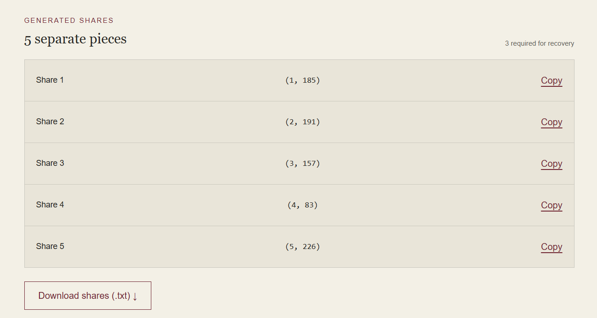

# Secret Share

Secret Share is a cryptography web application that demonstrates Shamir's Secret Sharing over the finite field GF(257). It allows users to split a numeric secret into multiple shares and reconstruct the original secret using a specified threshold of shares.

##  Live Demo

🔗 Live Demo: https://secretshare-demo.vercel.app

## Features

- **Split a secret:** Generate multiple shares from a numeric secret.
- **Threshold-based recovery:** Reconstruct a secret using the required number of valid shares.
- **Interactive learning:** Explore the concepts behind polynomial interpolation and finite fields.
- **Input validation:** Handle invalid inputs and recovery edge cases.
- **Responsive interface:** Use the application across desktop and mobile screens.
- **Automated tests:** Verify the core secret-sharing and reconstruction logic.

## How It Works

Secret Share demonstrates the core idea behind Shamir's Secret Sharing:

1. Choose a numeric secret.
2. Set the total number of shares and the minimum number required for recovery.
3. Generate shares using a randomly selected polynomial over a finite field.
4. Combine enough valid shares to reconstruct the original secret using Lagrange interpolation.

This project uses arithmetic over the finite field **GF(257)**.

## Tech Stack

- Next.js
- React
- TypeScript
- Tailwind CSS
- Vitest
